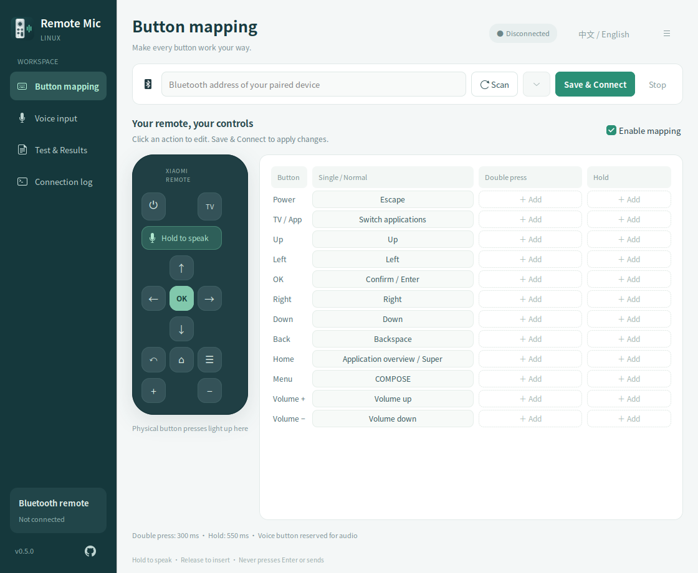
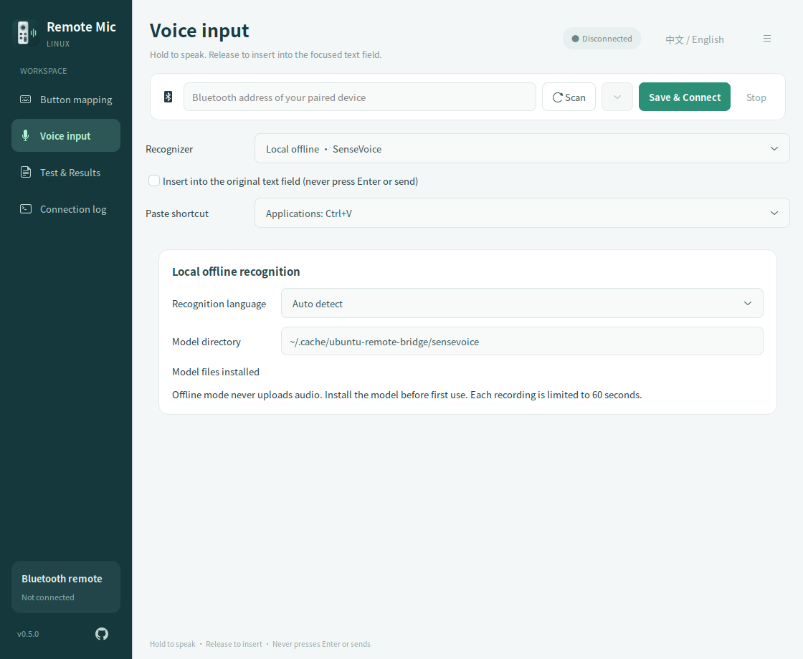
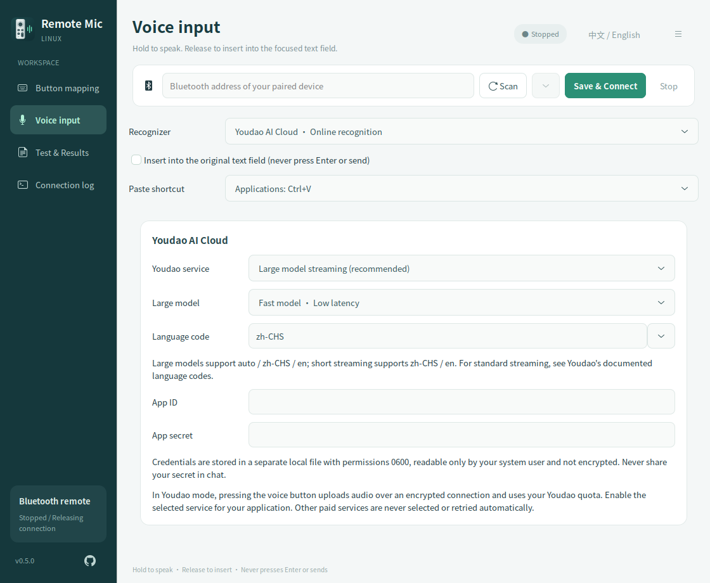
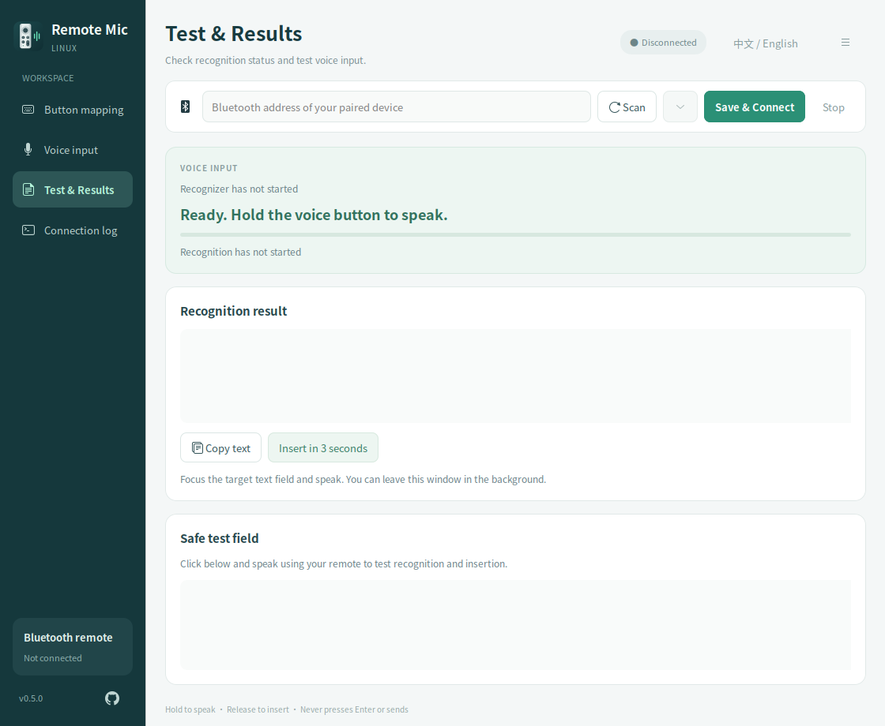

<div align="center">
  
  <h1>Remote Mic Linux</h1>
  <p>Remote Mic Linux brings Bluetooth remote control and push-to-talk voice typing to Linux, with customizable button mappings, local offline recognition, optional Youdao cloud recognition, and a persistent tray icon.</p>
  <p><strong>Control Linux with a Bluetooth remote. Hold the voice button, speak, and insert the text into the selected text field.</strong></p>
  <p>
    <a href="https://github.com/panhuahao/remote-mic-linux/releases/tag/v0.5.0"></a>
    <a href="#system-and-device-compatibility"></a>
    
    <a href="LICENSE.md"></a>
  </p>
  <p><a href="README.md">简体中文</a> · <strong>English</strong></p>
  <p><a href="https://github.com/panhuahao/remote-mic-linux/releases"><strong>Download AppImage / DEB</strong></a> · <a href="#first-use">Quick start</a> · <a href="https://github.com/panhuahao/remote-mic-linux/issues">Report an issue</a> · <a href="CHANGELOG.md">Changelog</a></p>
</div>

The current version is **v0.5.0**, available as AppImage and DEB packages built against **Ubuntu 24.04 LTS x86_64**. Container runtime and package checks passed on Ubuntu 24.04; desktop tests were performed on **Ubuntu 26.04.1 LTS**. Full desktop and hardware validation on Ubuntu 24.04 is the next priority.

> [!NOTE]
> **Project origin · SayAll**
>
> This project references and adapts code from **[SayAll / remote-mic-app](https://github.com/HD838A/remote-mic-app)** ([original product website](https://sayall.app/)). We thank its authors and contributors for publishing the remote voice protocol and related implementations. Remote Mic Linux is an independent, unofficial Linux adaptation. It is not affiliated with the SayAll commercial product and is not endorsed by its authors.

[Compatibility](#system-and-device-compatibility) · [Installation](#download-and-launch) · [Speech settings](#speech-recognition-settings) · [Text insertion](#text-insertion-and-its-limits) · [Roadmap](#roadmap) · [Contributing](CONTRIBUTING.md)

<p align="center">
  
  <br>
  <sub>Customizable buttons · Hold to speak · Type into the selected text field</sub>
</p>

## Features

- **Visual button mapping:** Configure single presses, double presses, and long presses. Assign preset actions, custom shortcuts, recorded key combinations, or installed applications.
- **Hold to speak, release to type:** Paste the final recognition result into the text field selected when speech starts. The app does not press Enter or send messages automatically.
- **Local offline recognition:** Run SenseVoice int8 on the local CPU. Supports Mandarin, English, Cantonese, Japanese, Korean, and automatic language detection. Download the model separately.
- **Optional cloud recognition:** Use your own Youdao AI Cloud account with large-model streaming, short-audio, real-time short-audio, or standard streaming recognition.
- **Persistent tray icon:** Keep the connection and voice typing active after closing the window. Restore, connect, stop, or quit from the tray. Launching the app again restores the existing window.
- **Chinese and English interface:** Switch instantly using the language button at the top of the window. The preference is saved independently of the speech recognition language.
- **Testing and diagnostics:** Inspect connection status, audio level, recognition source, live previews, and final results. Includes a safe test field, copying, and delayed insertion.
- **External voice applications:** Integrate through a PipeWire virtual microphone and configurable start/stop shortcuts, without changing the system's default microphone.

## System and device compatibility

### Linux environment

| Environment | Current status |
| --- | --- |
| Ubuntu 24.04 LTS · x86_64 | Build baseline; clean-container runtime, non-root UI/offline recognition, and DEB installation/removal verified; full real-machine validation pending |
| Ubuntu 26.04.1 LTS · x86_64 · GNOME Wayland + XWayland | New-package startup, virtual audio, and controlled X11/Wayland insertion verified; remote hardware results are retained from earlier versions |
| Ubuntu 22.04 and earlier | Outside the current binary baseline; standard system glibc is too old |
| Debian, Fedora, Arch, Linux Mint, and other distributions | Distribution compatibility has not been verified; running out of the box is not guaranteed |
| KDE Plasma, XFCE, and other desktops | Not verified; tray integration, focus detection, and text insertion may need further adaptation |
| Wayland sessions without X11/XWayland | Not currently supported; the GUI launch configuration requires X11/XWayland |
| ARM / aarch64 | Only x86_64 / amd64 application packages are available; running from source on ARM has not been verified |

**Neither AppImage nor DEB guarantees compatibility with every Linux system.** The v0.5.0 packages use an Ubuntu 24.04 build environment and target **x86_64 with glibc 2.39 or newer**; glibc is still provided by the host. The DEB targets the Ubuntu/Debian package ecosystem, while the AppImage can be tried on other distributions that provide the required host services. An older build baseline improves runtime compatibility, but does not replace real-machine tests of Bluetooth, permissions, audio services, and desktop text insertion. Passing build or container tests does not establish full desktop compatibility. The glibc 2.43 requirement of the old v0.4.0 package no longer applies to the new package. See [Testing](docs/TESTING.md) for the exact scope.

The host must still provide:

| System component | Purpose |
| --- | --- |
| Bluetooth adapter, BlueZ, and desktop D-Bus | Remote pairing, connection, and voice data reception |
| PipeWire user audio service | Virtual remote microphone |
| AT-SPI and X11/XWayland | Input target checks and clipboard bridging; the GUI currently uses the X11 backend |
| Read access to the remote's `/dev/input/event*` device and access to `/dev/uinput` | Receive remote button events and generate mapped keys and paste shortcuts |
| AppIndicator / StatusNotifier support | Tray icon and background operation; GNOME usually needs an AppIndicators extension |
| Fontconfig configuration and system fonts | Render the Chinese and English UI; Noto CJK fonts are recommended for Chinese |

A complete first-run device permission wizard is not yet available. Configure permissions for your user according to your distribution's policy. Do not make all input devices readable and writable by everyone.

### Remote controls

| Device | Verification status |
| --- | --- |
| Xiaomi Bluetooth Remote Control 2 / RC001 | Physical connection, button, and voice tests completed |
| Xiaomi Bluetooth Remote Control 2 Pro / RC003 | Adapted according to the relevant protocol; physical verification pending |
| Other Bluetooth remotes and Apple TV remotes | Not verified; compatibility is not guaranteed |

Successful Bluetooth pairing does not establish that a device has a compatible voice channel. The app icon is an original design and does not indicate Apple TV remote support.

## Download and launch

**Choose a package:** use the DEB for an Ubuntu installation, or the AppImage for portable use. Get both from [GitHub Releases](https://github.com/panhuahao/remote-mic-linux/releases).

| File | Purpose |
| --- | --- |
| `Remote-Mic-Linux-0.5.0-x86_64.AppImage` | Portable application with Python, GTK, recognition runtimes, and major dependencies |
| `remote-mic-linux_0.5.0_amd64.deb` | Ubuntu/Debian package with an application menu entry and package-managed installation, upgrades, and removal |
| `remote-mic-linux-0.5.0-source.tar.gz` / `.zip` | Source code, documentation, icons, tests, and build scripts |
| `SHA256SUMS` | Download integrity checksums |

Neither application package includes a speech model, accounts, API keys, pairing records, or user configuration.

### DEB installation for Ubuntu

Run in the download directory:

```sh
sudo apt install ./remote-mic-linux_0.5.0_amd64.deb
remote-mic-linux
```

You can also open **Remote Mic Linux** from the application menu. Install a newer DEB to upgrade. Use `sudo apt remove remote-mic-linux` to uninstall; personal settings and models are retained. Installation does not automatically grant access to input devices or enable login autostart.

When migrating from AppImage, quit the old instance first. If you previously ran `--install-desktop`, `~/.local/share/applications/io.github.panhuahao.RemoteMicLinux.desktop` may still point to the old AppImage and override the DEB entry. Move that file aside once it is no longer needed, or run `remote-mic-linux` directly. The package does not remove user launchers.

### Portable AppImage

```sh
chmod +x Remote-Mic-Linux-0.5.0-x86_64.AppImage
./Remote-Mic-Linux-0.5.0-x86_64.AppImage
```

After placing the AppImage in a permanent location, install its application menu entry and a launcher alongside the file:

```sh
./Remote-Mic-Linux-0.5.0-x86_64.AppImage --install-desktop
```

This installs launchers for the current user. It does not enable login autostart. Run the command again if you move the AppImage, so that the launcher points to the new location.

If the system cannot mount the AppImage, try extracting and running it:

```sh
./Remote-Mic-Linux-0.5.0-x86_64.AppImage --appimage-extract-and-run
```

## First use

Use the language button at the top of the window to switch between Chinese and English. The app remembers your choice. This changes only the interface language; choose the speech recognition language separately in the voice settings.

1. Pair the remote in your system's Bluetooth settings. Open Remote Mic Linux, scan for devices or enter the paired device's address, and select **Save & Connect**.
2. Configure actions in the button mapping page, then select **Save & Connect**. The voice button is reserved for push-to-talk.
3. Select local offline recognition or Youdao in the voice input settings. Install a model or enter credentials as described below. Keep automatic insertion into the original text field enabled, then select **Save & Connect**.
4. Verify recognition in the safe test field on the test and results page. Then click the text field in the application where you want to type.
5. Hold the remote's voice button, speak, release, and wait for the text. Keep the target window and text field unchanged during recognition; do not switch back to Remote Mic Linux.

After changing the recognition method, the interface marks the selection as not yet applied. Select **Save & Connect** to apply it. Previous results retain the name of the service that produced them, regardless of the current selection.

Closing the window hides it in the tray when a tray is available. To quit completely, use **Quit Remote Mic Linux** in the tray or the quit action in the window menu. If no tray is available, closing the window exits the app.

## Speech recognition settings

### Local offline recognition

Use this mode to process speech on your computer. Once the model has been downloaded, recognition works without a network connection and does not upload audio.

```sh
./Remote-Mic-Linux-0.5.0-x86_64.AppImage --install-model
```

For a DEB installation, use `remote-mic-linux --install-model`. The `remote-mic-linux` command accepts only application arguments, such as `--install-model`, `--version`, and `--self-test`; `--appimage-extract-and-run` is only for AppImage.

The download is approximately 239 MB and is stored in `~/.cache/ubuntu-remote-bridge/sensevoice/` by default. The installer checks the model SHA256 and the vocabulary Git blob. If the official download is unavailable, you can explicitly select a mirror with the same integrity checks:

```sh
./Remote-Mic-Linux-0.5.0-x86_64.AppImage --install-model --mirror
```

Select local offline recognition in the voice settings, confirm the model directory and recognition language, then save and connect. The model is covered by its publisher's separate license; see [Sources and third-party notices](SOURCES.md).

<details>
<summary><strong>View the local recognition settings</strong></summary>

<p align="center">
  
</p>

</details>

### Youdao AI Cloud recognition

You need your own Youdao AI Cloud API application with access to the selected recognition service. Usage consumes your account quota according to the platform's rules.

1. Create a Youdao AI Cloud application, obtain its application ID and secret, and enable the recognition service you want to use.
2. Select Youdao in the voice settings, then choose the service and recognition language. Large-model streaming recognition offers fast and standard model options.
3. Enter the ID and secret locally in the app, select **Save & Connect**, and test with the remote.

| Service | Operation | Current verification scope |
| --- | --- | --- |
| Large-model streaming recognition | Upload audio while the button is held; insert text after the final result is confirmed | Standard model verified with the real API and the user's remote; fast model is configurable but still needs testing |
| Real-time short-audio recognition | Upload audio chunks over WebSocket and merge returned segments | Verified against the real API using a public audio sample |
| Short-audio recognition | Upload a complete WAV after button release | Implemented and tested with mocks; real API verification pending |
| Standard streaming recognition | Upload audio chunks over WebSocket | Implemented and tested with mocks; real API verification pending |

The app uploads audio to the selected Youdao service over TLS. A failed request does not automatically fall back to another paid API. Built-in recognition limits each utterance to 60 seconds. Only confirmed final results trigger automatic text insertion.

<details>
<summary><strong>View the Youdao recognition settings</strong></summary>

<p align="center">
  
</p>

</details>

### External voice applications

In external application mode, select `Ubuntu Remote Microphone` as the other application's audio input and configure start/stop shortcuts. Recognition and text output are handled by that application. Only Vokie startup has been verified; recognition after login has not been tested.

## Text insertion and its limits

Text is inserted through the clipboard and a virtual paste shortcut. The default is `Ctrl+V`; terminals can use `Ctrl+Shift+V`, configured in the voice settings. The app attempts to restore the previous plain-text clipboard. Preservation of images or other non-text formats is not guaranteed.

To reduce the risk of pasting into the wrong place, automatic insertion is cancelled in the following cases. The result remains available to copy from the app:

- The target window or detectable input field changes during recognition.
- The connection is stopped, the remote disconnects, or the recognition result expires.
- The target is detected as a password field.

Target detection depends on accessibility information exposed by each application. For some applications, only the window can be checked; changes between fields in the same window or all password fields cannot be detected reliably. Text fields that disable pasting, require special shortcuts, or lack accessibility support may not accept automatic insertion.

The fixed-text insertion path has been verified in separate X11 and native Wayland GTK text fields. It has not been tested across all everyday applications. See [Testing](docs/TESTING.md) for methods and hardware verification scope.

<details>
<summary><strong>View the results and safe test field</strong></summary>

<p align="center">
  
</p>

</details>

## Troubleshooting

### Text is recognized but does not appear in the selected field

Make sure automatic insertion is enabled and select **Save & Connect**. Click the target text field before speaking and keep its focus until recognition finishes. Check `/dev/uinput` permissions and the paste shortcut. First use the safe test field to rule out a recognition problem, then test an external application. Terminals generally need `Ctrl+Shift+V`.

### The remote is not found, or buttons work but voice does not

Pair the remote in the system Bluetooth settings and wake it by pressing a button. Check whether it is connected to another host and whether it offers a compatible ATVV voice channel. Physical verification of the Remote Control 2 Pro and other models is still pending.

### There is no tray icon after closing the window

Check that your desktop supports AppIndicator / StatusNotifier. GNOME needs the corresponding extension enabled. Without tray support, closing the window exits the app. Login autostart is not yet provided.

### Startup fails on another Linux distribution

The v0.5.0 AppImage and DEB use Ubuntu 24.04 x86_64 as their build baseline and require glibc ≥ 2.39. If an error mentions `GLIBC_*`, extracting the AppImage will not fix an older host glibc. Ubuntu 22.04 and earlier need separate adaptation and builds. If mounting is the only AppImage problem, try the extract-and-run command above. Install the DEB with `apt` and inspect dependency errors rather than forcing installation without dependency checks.

You can check the version and runtime imports separately:

```sh
./Remote-Mic-Linux-0.5.0-x86_64.AppImage --version
./Remote-Mic-Linux-0.5.0-x86_64.AppImage --self-test
```

`--self-test` does not connect to the remote or upload audio. Success only means that the runtime dependencies it checks can be loaded. It does not verify Bluetooth, device permissions, or automatic text insertion.

## Data and privacy

| Data | Default location or handling |
| --- | --- |
| Interface language preference | `~/.config/ubuntu-remote-bridge/ui.json`, stored separately from the recognition language |
| Device and button settings | `~/.config/ubuntu-remote-bridge/config.json` |
| Youdao credentials | `youdao-credentials.json` in the same directory; stored as plain text with file mode `0600` |
| Local recognition model | `~/.cache/ubuntu-remote-bridge/sensevoice/` |
| Audio and recognition results | The GUI processes them in memory, without saving recordings or a persistent history database. Final text is displayed in the app and inserted into the target application according to your settings. |

Settings and model paths respect `XDG_CONFIG_HOME` / `XDG_CACHE_HOME`. The legacy `ubuntu-remote-bridge` directory name is retained for compatibility with earlier versions. In cloud mode, the selected service processes the audio. In external application mode, data handling depends on that application.

Do not commit API keys, real user configuration, Bluetooth device addresses, or personal recordings. Command-line `--headless` diagnostics may print recognized text; redact logs before sharing them.

To uninstall, quit the app first. For a DEB installation, run `sudo apt remove remote-mic-linux`. For AppImage or source installations, remove the corresponding files, generated launchers, and `io.github.panhuahao.RemoteMicLinux.desktop` and its icon from your user application directories. Remove user settings and downloaded models separately if desired.

## Run from source

These commands target Ubuntu. Install the equivalent packages on other distributions. Source installation uses the system GTK and creates a virtual environment for Python dependencies.

```sh
git clone https://github.com/panhuahao/remote-mic-linux.git
cd remote-mic-linux

sudo apt install \
  python3-venv python3-dev python3-gi python3-cairo python3-numpy \
  gir1.2-gtk-3.0 gir1.2-atspi-2.0 gir1.2-ayatanaappindicator3-0.1 \
  build-essential bluez pipewire-bin wl-clipboard libx11-6 xwayland

./install.sh

# Install the model for local recognition; skip this for Youdao.
.venv/bin/python install_model.py

./run.sh
```

`install.sh` installs an application menu entry for the current user. Device permissions still need to be configured separately. Use `./run.sh --autostart` to connect to the saved device at application startup; this does not enable login autostart.

### Development and testing

```sh
.venv/bin/python -m unittest discover -s tests -v
./run.sh --self-test
./run.sh --scan
```

On November 5, 2026, v0.5.0 passed **82 unit tests** on Ubuntu 24.04 / Python 3.12.3. An isolated non-root GUI also passed **15 language checks** and **5 recognition-source checks**. These tests cover the protocol, gestures, mocked recognition communication, input protections, and interface preferences without requiring a remote or calling paid APIs.

The new packages also passed offline Ubuntu 24.04 container runtime, local-model inference, and DEB installation/same-version reinstallation/removal checks. FUSE startup, virtual audio, and controlled X11/Wayland insertion passed on the current Ubuntu 26.04 host. Cross-version upgrades, a real Ubuntu 24.04 desktop, and a new round of hardware/cloud validation remain separate work; see [Testing](docs/TESTING.md).

`./run.sh --headless` provides connection and console diagnostics. Automatic insertion for built-in recognition is handled by the GUI.

See [RELEASE.md](RELEASE.md) for build and release instructions and [CONTRIBUTING.md](CONTRIBUTING.md) for contribution guidelines.

## Roadmap

Our next priorities are a **fully validated Ubuntu 24.04 experience** and **additional speech recognition providers**. The following work is planned, not implemented, and has no fixed release dates. Priorities may change with hardware availability, API access, and user feedback.

### 01 · Ubuntu 24.04 and more Linux systems

Test installation, pairing, remote voice input, cross-application insertion, tray behavior, and upgrades on an Ubuntu 24.04 machine. Then expand coverage to Debian, Linux Mint, Fedora, Arch, KDE Plasma, and XFCE. Maintain a compatibility matrix that distinguishes successful startup from verified end-to-end functionality.

### 02 · Additional speech recognition providers

Introduce a common recognition interface for streaming and complete-utterance APIs, with provider-specific credentials, endpoints, models, and languages. Alibaba Cloud, Volcengine, and Tencent Cloud are candidates, subject to API validation. Clearly describe audio uploads, billing ownership, and errors; provider switching will require an explicit user choice.

### 03 · First-run setup and device permissions

Add diagnostics and setup guidance for BlueZ, PipeWire, AT-SPI, XWayland, tray support, and input device permissions, with fixes tailored to the detected environment. Improve DEB installation, upgrades, removal, and AppImage startup.

### 04 · Reliable cross-application insertion

Add regression coverage for browsers, office software, editors, and terminals. Improve focus changes, clipboard restoration, cancellation, reconnection, and retry feedback to prevent misplaced or duplicate text.

### 05 · Remote controls and mapping profiles

Complete physical validation of the Remote Control 2 Pro / RC003 and record protocol and button compatibility for more devices. Add multiple mapping profiles, import/export, and switching by foreground application.

### 06 · Everyday use and maintenance

Add optional login autostart, version checks, and clear upgrade actions. Improve credential handling, redacted diagnostics, keyboard navigation, accessibility labels, Chinese and English copy, and layouts on smaller screens.

Additional offline models, ARM builds, and combination macros will also be evaluated according to demand. A native Wayland interface and insertion path without XWayland needs separate validation and is outside the current compatibility promise.

## Known limitations

The following features are not yet implemented:

- A common multi-provider configuration; multiple mapping profiles and automatic switching by foreground application.
- Combination macros; actively finding and focusing text fields; mobile input.
- A history database/MCP integration; usage statistics; login autostart and automatic updates.

See the [feature comparison](docs/FEATURE_COMPARISON.md) for differences from SayAll's public code. Some upstream product features rely on private modules and should not be treated as fully available in the public source.

Please report problems through [Issues](https://github.com/panhuahao/remote-mic-linux/issues) or contribute through a pull request. For compatibility reports, include the distribution, CPU architecture, desktop environment, X11/Wayland session type, device model, and steps to reproduce with private details removed.

## Sources, acknowledgements, and license

The project code is licensed under **[GPL-3.0-only](LICENSE.md)**.

ATVV protocol constants, capability parsing, IMA ADPCM decoding, framing/session handling, and protocol test vectors reference and adapt the public code of SayAll / `HD838A/remote-mic-app`. The initial adaptation is based on commit `96b9df005707c1268e47316e1ba46aed0ef42c63`. This project implements the Linux Bluetooth integration, PipeWire virtual audio source, evdev/uinput button mapping, GTK interface, local recognition integration, and Youdao APIs.

Thanks to SayAll and its contributors, as well as BlueZ, PipeWire, GTK/PyGObject, sherpa-onnx, SenseVoice, AppImage, and other dependency projects. Third-party software, models, and icons remain subject to their respective licenses; this project's license does not replace them. See [SOURCES.md](SOURCES.md) for the full source chain, upstream copyright, and third-party notices.

README screenshots were captured with a separate configuration containing no account credentials or real device addresses.
