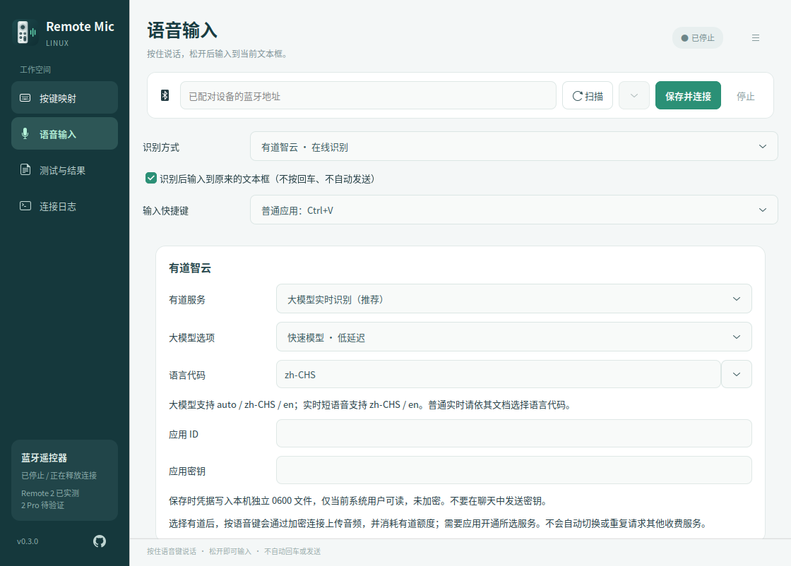
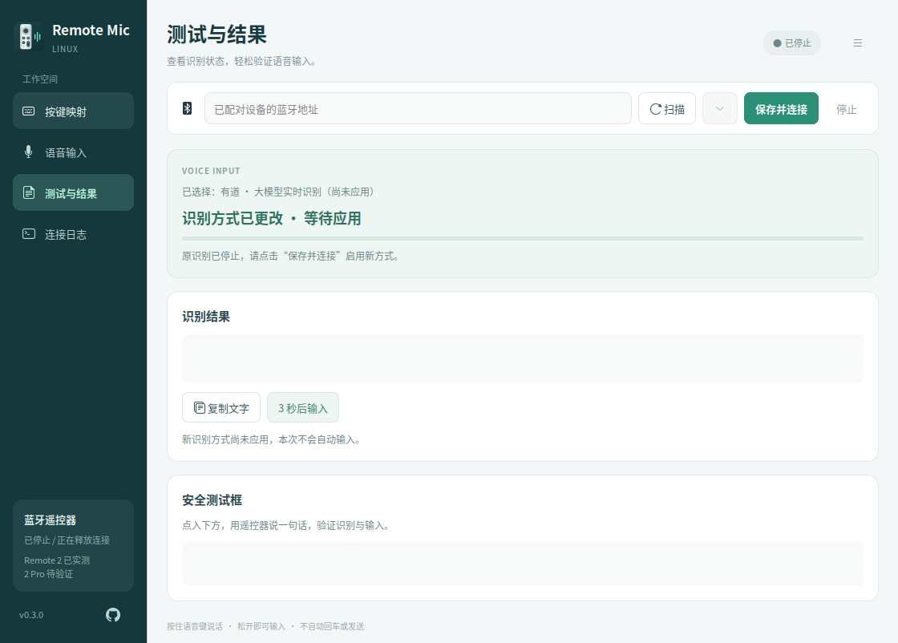

# Remote Mic Linux

**v0.3.0 · Ubuntu 26.04 x86_64 · 私有预览版**

> 本项目参考并适配自 **[SayAll / remote-mic-app](https://github.com/HD838A/remote-mic-app)**（[原项目官网](https://sayall.app/)）。感谢原作者及贡献者公开蓝牙遥控器语音协议和实现。Remote Mic Linux 是独立、非官方的 Linux 适配，与原项目商业产品没有隶属关系，也不代表原作者背书。

ATVV 协议常量、能力解析、IMA ADPCM 解码和测试向量参考并改编自上游公开代码。Linux 蓝牙接入、按键映射、GTK 界面、内置本地识别和有道接口由本项目实现。代码采用 **GPL-3.0-only**，归属和许可见 [SOURCES.md](SOURCES.md) 与 [LICENSE.md](LICENSE.md)。初始适配依据上游提交 96b9df005707c1268e47316e1ba46aed0ef42c63。

目前仓库保持私有，仅有权限的账号可查看代码和下载预览版；暂不公开发布。

## 能做什么

- 将小米蓝牙遥控器变成 Ubuntu 的按键控制器和按住说话的语音输入工具。
- 图形界面配置单击、双击、长按；支持预设动作、自定义快捷键、录制组合键、打开已安装应用。
- 本机 SenseVoice 离线识别，或使用自行配置的有道智云账号。
- 松开语音键后，将最终结果粘贴到开始说话时选中的输入框，**不自动回车、不发送消息**。
- 常驻 Ubuntu 顶部通知栏；关闭窗口后连接、映射和语音输入继续工作。
- 从通知栏恢复窗口、连接/停止、彻底退出；重复打开应用会唤回已有窗口。
- 提供识别预览、最终结果、安全测试框、复制文字和延时输入。

## 下载与启动 APP

从本仓库的 [Releases](https://github.com/panhuahao/remote-mic-linux/releases) 下载：

**Remote-Mic-Linux-0.3.0-x86_64.AppImage**

这是包含 Python、GTK、识别运行库和应用代码的可执行应用文件。源码 ZIP / tar.gz 是另一个附件。AppImage 不包含识别模型、账号、密钥、蓝牙配对记录或本机设置。

~~~sh
chmod +x Remote-Mic-Linux-0.3.0-x86_64.AppImage
./Remote-Mic-Linux-0.3.0-x86_64.AppImage
~~~

先将文件放到长期保留的位置，再添加应用列表和同目录启动图标：

~~~sh
./Remote-Mic-Linux-0.3.0-x86_64.AppImage --install-desktop
~~~

应用列表、Dock、窗口及通知栏使用统一的 **Remote Mic Linux** 名称和原创图标。图标采用银色直边圆角遥控器造型，不使用 Apple 或 SayAll 的 Logo，也不代表已支持 Apple TV 遥控器。

若系统无法挂载 AppImage，可尝试运行时自带的解包启动方式：

~~~sh
./Remote-Mic-Linux-0.3.0-x86_64.AppImage --appimage-extract-and-run
~~~

### 系统范围

当前构建目标和测试环境为 **Ubuntu 26.04.1 LTS、x86_64、GNOME Wayland + XWayland**。没有宣称兼容旧 Ubuntu、ARM 或所有 Linux 发行版。宿主机仍需提供 BlueZ、PipeWire、桌面 D-Bus/AT-SPI、XWayland 和访问遥控器输入节点、/dev/uinput 的权限。通知栏需要 Ubuntu AppIndicators 扩展（本机已启用）。

程序不主动更改系统默认麦克风。设备访问权限不足时需要按本机策略配置权限；不要把所有键盘设备设为任何人可读写。无需使用 Electron 的 --no-sandbox 参数。

## 日常使用

1. 在 Ubuntu 蓝牙设置中完成遥控器配对；打开应用，扫描或使用已保存的设备地址，点击“保存并连接”。
2. 在“按键映射”编辑动作后，再点“保存并连接”。未设置双击/长按的按键保留常规按住行为；双击等待 300 ms，长按阈值 550 ms。
3. 在“语音输入”选择本机或有道模式，保持“识别后输入到原来的文本框”开启，再点击“保存并连接”。切换方式会暂停旧连接/识别，并显示“尚未应用”；不会继续使用旧的有道连接。上一段结果保留并标注原来源。
4. **先点入另一个应用中要输入的文本框**，然后按住遥控器语音键说话，松开后等文字出现。识别期间不要切回本程序。
5. 关闭窗口即可收起到通知栏；完全退出需选择通知栏的“退出 Remote Mic Linux”或窗口右上菜单的“退出应用”。没有安装登录自启服务。

通知栏不可用时，关闭窗口会退出，避免留下无法找回的后台窗口。运行中通知栏扩展消失时，程序会恢复窗口。单纯收起不重新连接、不取消正在工作的桥接。

普通输入框使用 Ctrl+V，终端可在语音设置选择 Ctrl+Shift+V。目标窗口或可识别的输入框发生变化、停止连接、断开连接、检测到密码框时，会取消自动粘贴并保留结果供复制。部分应用不提供字段信息，只能校验窗口；不能保证识别所有密码框或同一窗口内所有焦点变化。

## 语音方式

| 模式 | 行为 | 当前验证范围 |
| --- | --- | --- |
| 本地 SenseVoice int8 | 松开后用本机 CPU 识别，不上传音频 | 公开样例、本机模型、真实遥控器与程序内输入框已验证 |
| 有道大模型实时识别 | 按住时上传，最终结果确认后输入；可选快速/标准模型 | 标准模型真实接口及用户遥控器输入已验证；快速模型可配置，需按账号实测 |
| 有道短语音识别 | 松开后上传完整 WAV | 已实现和模拟验证，真实服务待验证 |
| 有道实时短语音识别 | WebSocket 分块上传并接收片段 | 真实公开音频样例验证通过；已修复最终文本后 304 关闭误判 |
| 有道普通实时识别 | WebSocket 分块上传 | 已实现和模拟验证，真实服务待验证 |
| 外部应用 | PipeWire 虚拟麦克风配合开始/结束快捷键 | Vokie 仅验证启动，未登录验证识别 |

每段语音上限 60 秒。不会在失败后自动切换其他收费接口。实时预览与“最终识别结果”分开显示，只有最终确认的结果进入自动输入链路。

“测试与结果”单独显示当前识别来源，并为每段文字注明本机/有道及服务类型。下拉选择、已保存设置和上一段结果不再混用；未应用的本地选择不会显示旧有道的成功状态。

### 本地模型

首次使用需单独下载模型；已安装的模型会继续使用：

~~~sh
./Remote-Mic-Linux-0.3.0-x86_64.AppImage --install-model
# 官方下载不可用时，可明确选择镜像，仍进行校验：
./Remote-Mic-Linux-0.3.0-x86_64.AppImage --install-model --mirror
~~~

模型文件约 239 MB，默认位于 ~/.cache/ubuntu-remote-bridge/sensevoice。下载器校验模型 SHA256 与词表 Git blob。模型遵循发布方的独立许可，应用 GPL 许可不替代模型许可。

### 有道账号

1. 在有道智云创建 API 应用，取得应用 ID 和应用密钥，并为该应用开通选择的识别服务。
2. 在“语音输入”选择“有道智云”，选择对应服务和语言。大模型提供快速及标准模型；其他服务不使用该模型选项。
3. 仅在本机界面填入应用 ID/密钥，点击“保存并连接”。不要将密钥提交到仓库、截图或聊天中。
4. 点入目标输入框，用遥控器测试。会通过 TLS 将音频上传至有道并消耗账号额度。

凭据保存在独立的 0600 文件，未加密；应用密钥输入框隐藏内容。取消使用时可清空 ID/密钥后保存。没有自动收费重试。

### “有文字却显示失败”的修复

在有道实时短语音服务上，实测会先收到已确认的最终片段，再收到 closeCode=0、errorCode=304 的关闭消息。旧逻辑把这条关闭消息当成整段识别失败，界面只留下预览，无法进入自动输入。

v0.3.0 仅在**已经发送结束帧、全部片段均最终确认、文本非空、正常关闭标记成立**时接受该结束情况。仅有预览、未结束的录音或认证错误仍报错，不会用预览冒充最终结果。新录音会清空上一段输入状态，避免显示过期的成功提示。

## 验证与已知差距

当前自动测试 **52 项通过**。受控测试区分协议单元测试、公开样例真实 API、跨应用固定文本输入和用户实物验收，详情见 [docs/TESTING.md](docs/TESTING.md)。

- 小米遥控器 2 / RC001 已实物验证；2 Pro / RC003 尚待实测。
- 本地与有道大模型在程序内测试框已获用户确认；不能等同于所有日常应用均兼容。
- v0.3.0 包含通知栏常驻、统一图标/窗口身份、单实例唤回、现代化界面和 AppImage。
- 尚未实现多套映射方案、按前台应用自动切换、组合宏、历史库/MCP、使用统计、移动端输入、登录自启和自动更新。
- 详细上游差异和优先级见 [docs/FEATURE_COMPARISON.md](docs/FEATURE_COMPARISON.md)。上游私有组件和候选功能与公开核心实现分开标注。

## 源码运行与维护

~~~sh
sudo apt install python3-venv python3-dev python3-gi python3-cairo python3-numpy   gir1.2-gtk-3.0 gir1.2-atspi-2.0 gir1.2-ayatanaappindicator3-0.1   build-essential bluez pipewire-bin wl-clipboard libx11-6 xwayland
./install.sh
.venv/bin/python install_model.py
./run.sh --autostart
~~~

~~~sh
.venv/bin/python -m unittest discover -s tests -v
./run.sh --scan
./run.sh --headless
./run.sh --self-test
~~~

headless 用于连接和控制台诊断，控制台可能显示识别文本；自动粘贴由图形界面负责。源码版本需要本机 Python 环境；AppImage 使用自身运行库。

设置位于 ~/.config/ubuntu-remote-bridge/config.json，凭据为同目录 youdao-credentials.json。更名后保留旧目录名，兼容既有配置；不会把密钥或模型迁入项目。音频仅在内存处理，GUI 不保存用户录音或历史库；当前结果保留于界面及目标文本框。

卸载前从通知栏退出，再删除 AppImage/源码目录、用户应用目录中的 io.github.panhuahao.RemoteMicLinux.desktop 和对应图标。按需删除用户配置与模型；删除应用本身不会自动清除这些私有数据。

构建、校验和发布文件见 [RELEASE.md](RELEASE.md)，开发说明见 [CONTRIBUTING.md](CONTRIBUTING.md)，本版改动见 [CHANGELOG.md](CHANGELOG.md)。所有截图均使用空设备地址、无凭据的独立配置拍摄。
