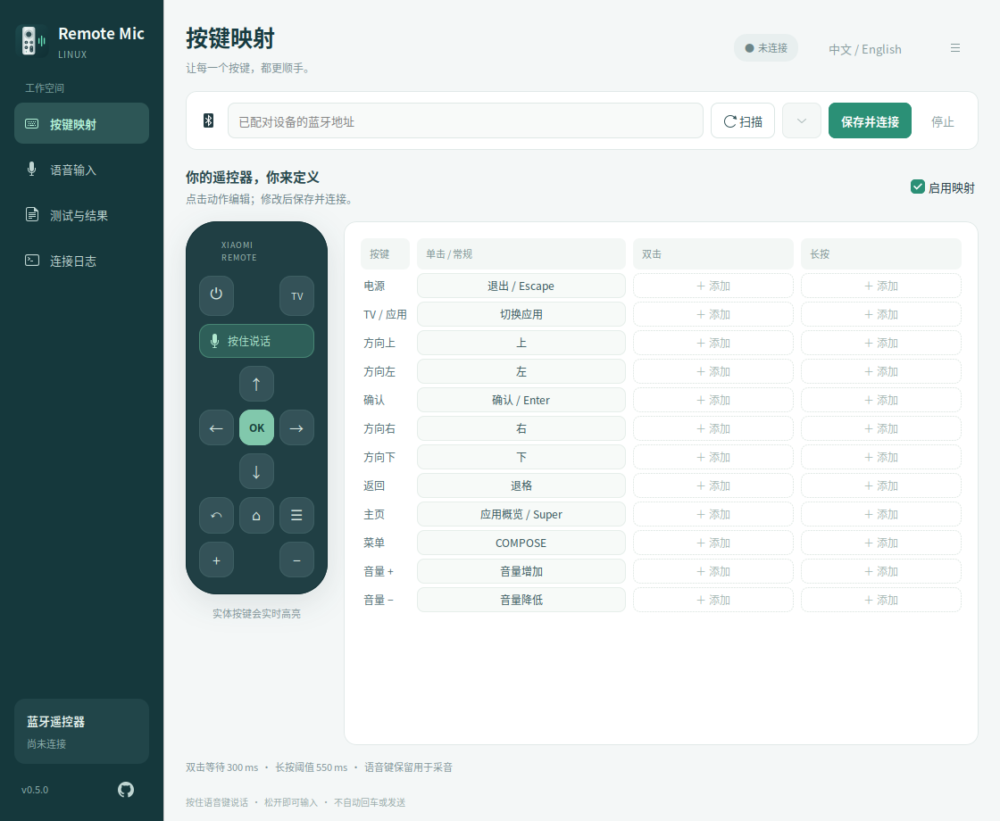
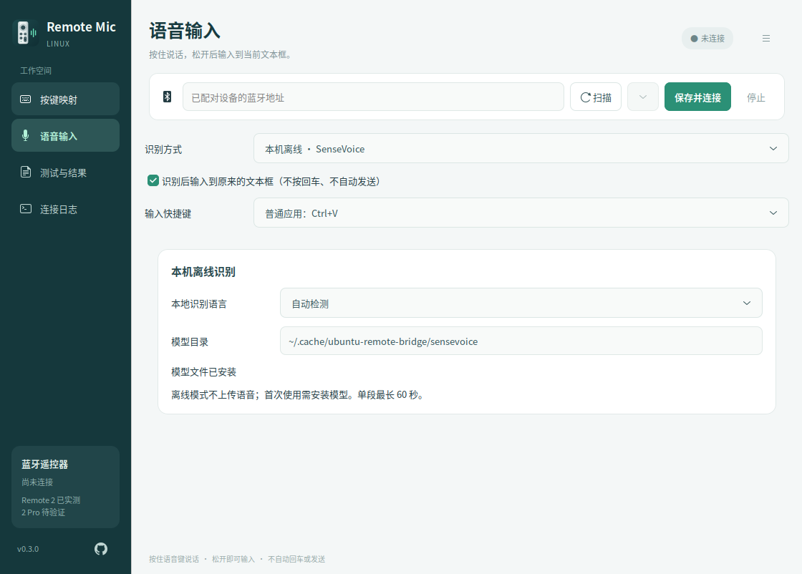

<div align="center">
  
  <h1>Remote Mic Linux</h1>
  <p>Remote Mic Linux brings Bluetooth remote control and push-to-talk voice typing to Linux, with customizable button mappings, local offline recognition, optional Youdao cloud recognition, and a persistent tray icon.</p>
  <p><strong>用蓝牙遥控器控制 Linux，按住语音键，把说的话输入当前文本框。</strong></p>
  <p>
    <a href="https://github.com/panhuahao/remote-mic-linux/releases/tag/v0.5.0"></a>
    <a href="#系统与设备兼容性"></a>
    
    <a href="LICENSE.md"></a>
  </p>
  <p><strong>简体中文</strong> · <a href="README.en.md">English</a></p>
  <p><a href="https://github.com/panhuahao/remote-mic-linux/releases"><strong>下载 AppImage / DEB</strong></a> · <a href="#第一次使用">快速上手</a> · <a href="https://github.com/panhuahao/remote-mic-linux/issues">反馈问题</a> · <a href="CHANGELOG.md">更新记录</a></p>
</div>

Remote Mic Linux 提供可视化按键映射、本地离线语音识别、有道智云识别和通知栏常驻。当前版本为 **v0.5.0**，提供 AppImage 和 DEB 两种安装方式，构建基线下调到 **Ubuntu 24.04 LTS x86_64**。Ubuntu 24.04 的容器运行与安装包检查已通过，桌面测试在 **Ubuntu 26.04.1 LTS** 完成；Ubuntu 24.04 的完整桌面与硬件验收将优先推进。

> [!NOTE]
> **项目来源 · SayAll**
>
> 本项目参考并改编自 **[SayAll / remote-mic-app](https://github.com/HD838A/remote-mic-app)**（[原项目官网](https://sayall.app/)）。感谢原作者及贡献者公开遥控器语音协议和相关实现。Remote Mic Linux 是独立、非官方的 Linux 适配项目，与 SayAll 商业产品没有隶属关系，也不代表原作者背书。

[系统兼容性](#系统与设备兼容性) · [安装教程](#下载与启动) · [语音设置](#语音识别设置) · [自动输入](#自动输入与使用边界) · [开发规划](#开发规划) · [参与贡献](CONTRIBUTING.md)

<p align="center">
  
  <br>
  <sub>自定义按键 · 按住说话 · 输入到选中的文本框</sub>
</p>

## 功能

- **图形化按键映射**：配置单击、双击和长按，支持预设动作、自定义快捷键、录制组合键和打开已安装应用。
- **按住说话，松开输入**：把最终识别文字粘贴到开始说话时选中的文本框，不自动回车或发送消息。
- **本地离线识别**：使用 SenseVoice int8 在本机 CPU 上识别，支持普通话、英语、粤语、日语、韩语及自动检测；模型需单独下载。
- **可选云端识别**：使用自己的有道智云账号，选择大模型实时识别、短语音识别、实时短语音识别或普通实时识别。
- **通知栏常驻**：关闭窗口后继续连接和输入，从通知栏恢复、连接、停止或退出；重复启动会唤回已有窗口。
- **中英文界面**：通过窗口顶部的语言按钮即时切换，自动保存偏好；界面语言与语音识别语言分别设置。
- **测试与诊断**：查看连接状态、音量、识别来源、实时预览和最终结果，提供安全测试框、复制与延时输入。
- **外部应用接入**：通过 PipeWire 虚拟麦克风和开始/结束快捷键连接外部语音应用，不主动更改系统默认麦克风。

## 系统与设备兼容性

### Linux 环境

| 环境 | 当前支持情况 |
| --- | --- |
| Ubuntu 24.04 LTS · x86_64 | 构建基线；干净容器运行、普通用户界面/离线识别及 DEB 安装卸载已验证；完整实机验收待完成 |
| Ubuntu 26.04.1 LTS · x86_64 · GNOME Wayland + XWayland | 新包启动、虚拟音源与受控 X11/Wayland 输入已验证；遥控器实测沿用前版记录 |
| Ubuntu 22.04 及更早版本 | 不在当前二进制包的支持基线内，标准系统 glibc 版本过旧 |
| Debian、Fedora、Arch、Linux Mint 等其他发行版 | 尚未完成发行版兼容性验证，不能保证直接运行 |
| KDE Plasma、XFCE 或其他桌面 | 尚未验证，通知栏、焦点检测和自动输入可能需要额外适配 |
| 不提供 X11/XWayland 的纯 Wayland 会话 | 当前图形启动方式依赖 X11/XWayland，暂不支持此环境 |
| ARM / aarch64 | 当前仅提供 x86_64 / amd64 应用包，ARM 源码运行也尚未验证 |

**AppImage 和 DEB 均不意味着兼容所有 Linux 系统。** v0.5.0 使用 Ubuntu 24.04 构建环境，面向 **x86_64、glibc 2.39 或更新版本**；glibc 仍由宿主提供。DEB 面向 Ubuntu/Debian 软件包体系，AppImage 可供其他满足依赖的发行版尝试。降低构建基线解决的是运行库兼容问题，不能替代蓝牙、设备权限、音频服务和桌面输入的实机测试。构建或容器测试通过，也不代表完整桌面体验已验收。v0.4.0 旧包的 glibc 2.43 要求已不适用于新包，详细范围见 [验证说明](docs/TESTING.md)。

宿主系统仍需提供以下能力：

| 系统组件 | 用途 |
| --- | --- |
| 蓝牙适配器、BlueZ 和桌面 D-Bus | 遥控器配对、连接与语音数据接收 |
| PipeWire 用户音频服务 | 创建遥控器虚拟麦克风 |
| AT-SPI、X11/XWayland | 检查输入目标并桥接剪贴板；当前 GUI 使用 X11 后端 |
| 遥控器对应 `/dev/input/event*` 的读取权限，以及 `/dev/uinput` 的访问权限 | 接收遥控器按键、生成映射按键和粘贴快捷键 |
| AppIndicator / StatusNotifier 支持 | 通知栏图标和后台常驻；GNOME 通常需要 AppIndicators 扩展 |
| Fontconfig 配置及系统字体 | 显示中英文界面；建议安装 Noto CJK 中文字体 |

首次安装尚无完整设备权限向导。请按发行版策略配置当前用户的权限；不要将全部输入设备设为所有人可读写。

### 遥控器

| 设备 | 当前验证情况 |
| --- | --- |
| 小米蓝牙遥控器 2 / RC001 | 已进行实物连接、按键和语音测试 |
| 小米蓝牙遥控器 2 Pro / RC003 | 已按相关协议适配，尚待实物验证 |
| 其他蓝牙遥控器、Apple TV 遥控器 | 尚未验证，不保证兼容 |

蓝牙配对成功不代表设备具备兼容的语音通道。应用图标为本项目原创，不表示支持 Apple TV 遥控器。

## 下载与启动

**选择安装方式：** Ubuntu 用户可使用 DEB 安装包；需要便携运行时选择 AppImage。两种包均可从 [GitHub Releases](https://github.com/panhuahao/remote-mic-linux/releases) 下载。

| 文件 | 用途 |
| --- | --- |
| `Remote-Mic-Linux-0.5.0-x86_64.AppImage` | 便携应用，包含 Python、GTK、识别运行库和主要依赖 |
| `remote-mic-linux_0.5.0_amd64.deb` | Ubuntu/Debian 安装包，提供应用菜单入口，便于安装、升级和卸载 |
| `remote-mic-linux-0.5.0-source.tar.gz` / `.zip` | 源码、文档、图标、测试与构建脚本 |
| `SHA256SUMS` | 校验下载文件的完整性 |

两种应用包**均不包含语音模型**，也不包含账号、密钥、配对记录或用户配置。

### DEB 安装（Ubuntu 用户）

在下载目录执行：

```sh
sudo apt install ./remote-mic-linux_0.5.0_amd64.deb
remote-mic-linux
```

也可从应用列表打开 **Remote Mic Linux**。之后安装新版 DEB 即可升级；卸载使用 `sudo apt remove remote-mic-linux`，个人配置与模型保留。安装包不会自动授予输入设备权限，也不会设置登录自启。

从 AppImage 迁移时，请先退出旧实例。若曾运行 `--install-desktop`，用户级 `~/.local/share/applications/io.github.panhuahao.RemoteMicLinux.desktop` 可能仍指向旧 AppImage，并覆盖 DEB 入口。确认不再使用后移走该文件，或直接运行 `remote-mic-linux`；安装包不会删除用户入口。

### AppImage 便携运行

```sh
chmod +x Remote-Mic-Linux-0.5.0-x86_64.AppImage
./Remote-Mic-Linux-0.5.0-x86_64.AppImage
```

将应用放在长期保留的位置后，可安装应用列表图标和同目录启动入口：

```sh
./Remote-Mic-Linux-0.5.0-x86_64.AppImage --install-desktop
```

此操作为当前用户安装启动入口，不会设置登录自启。移动 AppImage 后需重新执行，以更新启动路径。

如果系统无法挂载 AppImage，可尝试解包运行：

```sh
./Remote-Mic-Linux-0.5.0-x86_64.AppImage --appimage-extract-and-run
```

## 第一次使用

窗口顶部提供中英文切换按钮，切换后会记住选择。它只改变应用界面语言；识别普通话、英语或其他语言，仍需在“语音输入”中单独选择。

1. 在系统蓝牙设置中完成遥控器配对。打开 Remote Mic Linux，扫描设备或填写已配对设备的地址，点击“保存并连接”。
2. 在“按键映射”中配置动作，修改后点击“保存并连接”。语音键用于按住说话。
3. 在“语音输入”选择本机离线或有道智云，按下文安装模型或填写凭据。保持“识别后输入到原来的文本框”开启，再点击“保存并连接”。
4. 先在“测试与结果”的安全测试框中验证识别，再点击其他应用中需要输入的文本框。
5. 按住遥控器语音键说话，松开后等待文字出现。识别期间保持目标窗口和输入框不变，不要切回 Remote Mic Linux。

修改识别方式后，界面会显示“尚未应用”，需点击“保存并连接”生效。历史结果保留其实际识别来源，不会随着下拉选项改变。

关闭窗口会收起到可用的通知栏；彻底退出请使用通知栏“退出 Remote Mic Linux”或窗口菜单“退出应用”。如果通知栏不可用，关闭窗口会退出程序。

## 语音识别设置

### 本地离线识别

适合希望在本机处理语音的用户。首次下载模型后，识别不需要联网，也不上传音频。

```sh
./Remote-Mic-Linux-0.5.0-x86_64.AppImage --install-model
```

使用 DEB 安装的用户可运行 `remote-mic-linux --install-model`。`remote-mic-linux` 只接受应用自身参数，如 `--install-model`、`--version`、`--self-test`；`--appimage-extract-and-run` 仅用于 AppImage。

下载内容约 239 MB，默认保存到 `~/.cache/ubuntu-remote-bridge/sensevoice/`。下载器校验模型 SHA256 和词表 Git blob。官方下载不可用时，可明确选择镜像源，校验方式不变：

```sh
./Remote-Mic-Linux-0.5.0-x86_64.AppImage --install-model --mirror
```

在“语音输入”选择本机离线模式，确认模型目录与语言后保存连接。模型适用发布方的独立许可，详见 [来源与第三方声明](SOURCES.md)。

<details>
<summary><strong>查看本地识别界面</strong></summary>

<p align="center">
  
</p>

</details>

### 有道智云识别

需要自己的有道智云 API 应用及对应服务权限，按平台规则消耗账号额度。

1. 在有道智云创建应用，获取应用 ID 和应用密钥，并开通需要的识别服务。
2. 在“语音输入”选择“有道智云”，选择服务和语言；大模型实时识别可选快速模型或标准模型。
3. 在本机界面填写 ID 和密钥，点击“保存并连接”，再使用遥控器测试。

| 服务 | 工作方式 | 当前验证范围 |
| --- | --- | --- |
| 大模型实时识别 | 按住时上传音频，最终结果确认后输入 | 标准模型已完成真实接口与用户遥控器测试；快速模型可配置，仍需实测 |
| 实时短语音识别 | WebSocket 分块上传，接收并合并片段 | 公开音频样例已通过真实接口验证 |
| 短语音识别 | 松开后上传完整 WAV | 已实现并进行模拟测试，真实接口待验证 |
| 普通实时识别 | WebSocket 分块上传 | 已实现并进行模拟测试，真实接口待验证 |

应用通过 TLS 将音频上传至所选有道服务。识别失败时不会自动切换到其他收费接口。内置识别单段最长 60 秒，只有最终确认的结果会触发自动输入。

<details>
<summary><strong>查看有道识别界面</strong></summary>

<p align="center">
  
</p>

</details>

### 外部语音应用

可选择外部应用模式，将 `Ubuntu Remote Microphone` 作为该应用的输入源，并配置开始/结束快捷键。该模式的识别和文字输出取决于外部应用；目前仅验证了 Vokie 启动，未完成登录后的识别验证。

## 自动输入与使用边界

文字输入使用剪贴板和虚拟粘贴快捷键。普通应用默认 `Ctrl+V`；终端可在“语音输入”中改为 `Ctrl+Shift+V`。程序会尝试恢复原有纯文本剪贴板，不承诺保留图片等非文本格式。

为避免把文字输入错误位置，以下情况会取消自动粘贴，结果仍可在界面复制：

- 识别期间目标窗口或可检测的输入框发生变化。
- 停止连接、遥控器断开或识别结果已过期。
- 检测到目标为密码框。

目标检测依赖应用公开的无障碍信息。部分应用只能检查窗口，无法可靠识别同一窗口内的字段变化或所有密码框。禁用粘贴、使用特殊快捷键或缺少无障碍支持的输入框可能无法自动输入。

当前已在独立的 X11 和原生 Wayland GTK 输入框中验证固定文本输入链路，尚未覆盖所有日常应用。详细方法和实物测试范围见 [验证说明](docs/TESTING.md)。

<details>
<summary><strong>查看识别结果与安全测试框</strong></summary>

<p align="center">
  
</p>

</details>

## 常见问题

### 能识别文字，但没有输入到选中的文本框

确认已开启自动输入并点击“保存并连接”。开始说话前先点击目标文本框，识别完成前保持焦点不变；检查 `/dev/uinput` 权限和输入快捷键。先用安全测试框排除识别问题，再测试外部应用。终端通常需要 `Ctrl+Shift+V`。

### 找不到遥控器，或只有按键没有语音

先在系统蓝牙设置中配对，并按键唤醒遥控器。检查是否被其他主机连接，以及设备是否提供兼容的 ATVV 语音通道。遥控器 2 Pro 和其他型号尚未完成实物验收。

### 关闭后没有通知栏图标

确认桌面提供 AppIndicator / StatusNotifier 支持。GNOME 需启用相应扩展；缺少通知栏支持时，关闭窗口会退出。当前尚未提供登录自启。

### 其他 Linux 系统启动失败

v0.5.0 的 AppImage 和 DEB 以 Ubuntu 24.04 x86_64 为构建基线，要求 glibc ≥ 2.39。若报错涉及 `GLIBC_*`，解包运行也无法解决宿主 glibc 过旧；Ubuntu 22.04 及更早系统需另外适配和构建。若只是 AppImage 无法挂载，可尝试前文的解包运行方式。DEB 的依赖问题请使用 `apt` 安装并查看其错误信息；不建议强制跳过依赖检查。

依赖导入可单独检查：

```sh
./Remote-Mic-Linux-0.5.0-x86_64.AppImage --version
./Remote-Mic-Linux-0.5.0-x86_64.AppImage --self-test
```

`--self-test` 不连接遥控器、不上传音频；通过仅表示所检查的运行依赖能加载，不代表蓝牙、设备权限或自动输入可用。

## 数据与隐私

| 内容 | 默认位置或处理方式 |
| --- | --- |
| 界面语言偏好 | `~/.config/ubuntu-remote-bridge/ui.json`，与识别语言分开保存 |
| 设备与按键设置 | `~/.config/ubuntu-remote-bridge/config.json` |
| 有道凭据 | 同目录的 `youdao-credentials.json`，权限为 `0600`，明文保存 |
| 本地识别模型 | `~/.cache/ubuntu-remote-bridge/sensevoice/` |
| 语音与识别结果 | GUI 在内存中处理，不保存录音文件或持久化历史库；最终结果显示在界面，并按设置输入目标应用 |

设置和模型路径遵循 `XDG_CONFIG_HOME` / `XDG_CACHE_HOME`；保留旧目录名 `ubuntu-remote-bridge` 以兼容早期版本。云端模式的音频由所选服务处理；外部应用模式的数据处理取决于外部应用。

不要提交密钥、真实用户配置、蓝牙设备地址或个人录音。命令行 `--headless` 诊断可能输出识别文字，分享日志前请自行脱敏。

卸载时先退出程序。DEB 使用 `sudo apt remove remote-mic-linux`；AppImage 或源码安装需删除对应文件、生成的启动入口，以及用户应用目录中的 `io.github.panhuahao.RemoteMicLinux.desktop` 和对应图标。用户配置与模型需按需单独删除。

## 从源码运行

以下命令面向 Ubuntu，其他发行版需安装对应的软件包。源码安装使用系统 GTK，并为 Python 依赖建立虚拟环境。

```sh
git clone https://github.com/panhuahao/remote-mic-linux.git
cd remote-mic-linux

sudo apt install \
  python3-venv python3-dev python3-gi python3-cairo python3-numpy \
  gir1.2-gtk-3.0 gir1.2-atspi-2.0 gir1.2-ayatanaappindicator3-0.1 \
  build-essential bluez pipewire-bin wl-clipboard libx11-6 xwayland

./install.sh

# 使用本地识别时安装模型；使用有道则可跳过此步。
.venv/bin/python install_model.py

./run.sh
```

`install.sh` 会安装当前用户的应用列表图标。设备权限仍需另行配置。需要启动后自动连接已保存设备时，使用 `./run.sh --autostart`；此参数不等于登录自启。

### 开发与测试

```sh
.venv/bin/python -m unittest discover -s tests -v
./run.sh --self-test
./run.sh --scan
```

2026-11-05，v0.5.0 在 Ubuntu 24.04 / Python 3.12.3 环境通过 **82 项单元测试**；普通用户隔离界面的 **15 项中英文检查**和 **5 项识别来源检查**也通过。测试覆盖协议、手势、模拟识别通信、输入保护及界面偏好，不需要遥控器，也不调用真实收费接口。

新包还通过 Ubuntu 24.04 断网容器运行、离线模型推理和 DEB 安装/同版本重装/卸载检查；当前 Ubuntu 26.04 主机的 FUSE 启动、虚拟音源与受控 X11/Wayland 输入通过。跨版本升级、Ubuntu 24.04 真实桌面和新一轮硬件/云服务验收仍需另测，详见 [docs/TESTING.md](docs/TESTING.md)。

`./run.sh --headless` 用于连接和控制台诊断；内置识别的自动粘贴由 GUI 负责。

构建和发布方法见 [RELEASE.md](RELEASE.md)，贡献约定见 [CONTRIBUTING.md](CONTRIBUTING.md)。

## 开发规划

接下来优先完善 **Ubuntu 24.04 的完整使用体验**，并接入 **更多语音识别提供商**。以下列出计划中的工作，不表示已经实现，也不承诺固定发布日期；实际顺序将结合硬件条件、接口可用性和用户反馈调整。

### 01 · Ubuntu 24.04 与更多 Linux 系统

在 Ubuntu 24.04 实机上完成安装、配对、遥控器语音、跨应用输入、通知栏和升级测试；随后逐步覆盖 Debian、Linux Mint、Fedora、Arch，以及 KDE Plasma、XFCE 等桌面。分别记录“能启动”和“完整功能已验证”，持续维护兼容矩阵。

### 02 · 更多语音识别提供商

抽象统一的识别接口，支持流式与整段识别，按提供商配置凭据、服务地址、模型与语言。阿里云、火山引擎、腾讯云等列为候选，具体接入以接口验证为准。清楚标注上传范围、计费归属和错误原因；切换服务由用户明确选择。

### 03 · 首次运行与设备权限

增加系统诊断和引导，检查 BlueZ、PipeWire、AT-SPI、XWayland、通知栏和输入设备权限，提供针对当前环境的修复建议；完善 DEB 安装、升级、卸载和 AppImage 启动体验。

### 04 · 跨应用输入可靠性

增加浏览器、办公软件、编辑器和终端的回归用例；改善焦点变化、剪贴板恢复、识别取消、断线重连及失败重试提示，避免误粘贴或重复输入。

### 05 · 遥控器与按键方案

完成遥控器 2 Pro / RC003 的实物验收，建立更多设备的协议与按键兼容记录；增加多套映射方案、导入导出和按前台应用切换。

### 06 · 日常使用与维护

提供可选择的登录自启、版本检查与明确的升级入口；完善凭据管理、脱敏诊断导出、键盘导航、无障碍标签、中英文文案和小屏布局。

更多离线模型、ARM 构建、组合宏等方向也会根据需求评估。原生 Wayland 下不依赖 XWayland 的界面与输入方案需要单独验证，不纳入当前兼容承诺。

## 已知限制

当前尚未实现的功能：

- 多提供商统一配置、多套映射方案、按前台应用自动切换。
- 组合宏、主动寻找并聚焦输入框、移动端输入。
- 历史库/MCP、使用统计、登录自启和自动更新。

与 SayAll 公开代码的具体差异见 [功能对照](docs/FEATURE_COMPARISON.md)；其中部分上游产品能力依赖私有模块，不能视为公开代码已完整提供。

欢迎通过 [Issues](https://github.com/panhuahao/remote-mic-linux/issues) 报告问题或通过 Pull Request 贡献。兼容性反馈请提供发行版、CPU 架构、桌面环境、X11/Wayland 会话类型、设备型号及脱敏后的复现步骤。

## 来源、致谢与许可证

本项目代码采用 **[GPL-3.0-only](LICENSE.md)**。

ATVV 协议常量、能力解析、IMA ADPCM 解码、分帧/会话处理及协议测试向量，参考并改编自 SayAll / `HD838A/remote-mic-app` 的公开代码，初始适配依据提交 `96b9df005707c1268e47316e1ba46aed0ef42c63`。Linux 蓝牙接入、PipeWire 虚拟音源、evdev/uinput 按键映射、GTK 界面、本地识别集成及有道接口由本项目实现。

感谢 SayAll 及相关贡献者，以及 BlueZ、PipeWire、GTK/PyGObject、sherpa-onnx、SenseVoice、AppImage 和其他依赖项目。第三方软件、模型和图标适用各自许可；本项目许可证不替代这些许可。完整来源链、上游版权及第三方声明见 [SOURCES.md](SOURCES.md)。

README 截图使用无账号凭据、无真实设备地址的独立配置拍摄。
